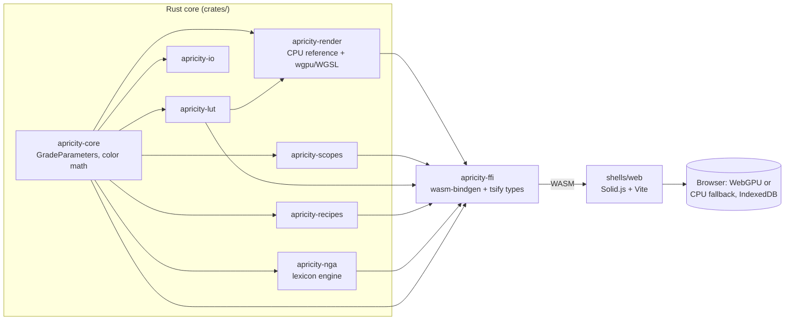

# Apricity

Apricity is a color grading app that runs in the browser. You describe a look in plain words, like "cold, desaturated noir", and an on-device agent turns it into explicit color adjustments. Every adjustment is listed with the reason for it and is a control you can change by hand.

**Live app:** https://iqbalhussein.github.io/Apricity/ (goes live once GitHub Pages is enabled for the repository and this branch is merged to `main`; see [Deploy](#deploy)).

**Privacy.** All processing happens on your device. Your photos and videos are never uploaded. The app has no server: it loads its code from GitHub Pages, and everything after that, including the AI agent, runs inside your browser. Recipes, history, imported LUTs and usage counters are stored in your browser's IndexedDB and stay there.

## What v1.0 does

- **Two-stage grading.** Stage 1, Correction, fixes exposure, white balance and black point, with an Auto mode for each and an input profile for sRGB, ARRI LogC3, Sony S-Log3, Panasonic V-Log and Apple Log. Stage 2, Grade, sets the look. The two stay in separate panels.
- **On-device AI agent with Explainability.** A deterministic lexicon engine (ADR-0006) maps moods, palettes, film stocks, genres and technical terms to parameter changes. After each prompt the Explainability Panel lists every change as before and after, with a rationale that quotes your words, and a button that jumps to the control. Prompts can be applied fresh, refined ("a bit warmer, less green"), or randomized with Surprise me.
- **Manual Console.** Light, Color, lift/gamma/gain wheels, 8-band HSL, master and RGB tone curves, split tone, vignette, seeded grain, and LUT strength. Every slider is generated from one parameter table, so the AI and your hands drive the same controls.
- **Scopes.** Luma waveform, RGB parade, vectorscope with graticule, histogram, and a broadcast-legal badge.
- **Review tools.** A wipe divider against the original, Stage 1 only, the previous grade, or an imported reference image. False color and zebra overlays. Zoom and pan.
- **A/B grades and history.** Two live grade slots with one-key switching, and undo/redo of up to 200 steps.
- **Recipes.** Save a grade, rename it, export or import it as a `.json` file, or start from six built-in looks.
- **LUTs.** Import a `.cube` and set its strength. Export your grade as a `.cube` at 17, 33 or 65 points, either the creative grade alone or the full pipeline.
- **Export.** JPEG, PNG and WebP images at full resolution (Free is capped at 2048 px on the long edge and carries a small mark). Video export is described in the [user guide](docs/user-guide.md).
- **Works offline.** After the first visit, a service worker caches the app so grading works without a connection. It is also installable as a PWA.
- **Free and Pro tiers.** The tier limits from PRD section 9.1 are built in. There is no checkout yet (ADR-0009), so during the beta every user gets Pro.

Without WebGPU the app renders the preview on the CPU at reduced resolution and shows a banner. Grading, the AI agent, scopes and export still work.

## Architecture

A portable Rust core holds all color science. Shells add only UI and host I/O. The web shell loads the core as WebAssembly through one FFI crate.



`apricity-io` decodes images for native shells and tests. The web shell decodes with the browser, so it does not link that crate.

The render pipeline always works in 32-bit float scene-linear Rec.2020:

```
source (sRGB or camera log)
  -> Stage 1 correction: decode, exposure, white balance, black point, log-to-display
  -> scene-linear Rec.2020
  -> Stage 2 grade: tone, color, wheels, HSL, split tone, curves, LUT, vignette, grain
  -> output transform (display encoding)
  -> optional preview overlay (false color, zebra)
```

Three rules keep the pieces honest:

- **One schema.** `GradeParameters` in `apricity-core` is the shape of the AI output, the Recipe file and the Manual Console. TypeScript types are generated from the Rust structs and are never written by hand.
- **One shader source, one reference.** The WGSL shaders mirror the pure-Rust CPU implementation. Golden-image and CPU/GPU parity tests (at most 1 LSB at 8-bit) run on lavapipe in CI.
- **No hidden randomness.** Grain and Surprise me take explicit seeds, and pipeline code reads no clock.

## Quick start

Prerequisites:

- Rust stable (1.88 or newer) with the wasm target: `rustup target add wasm32-unknown-unknown`
- `wasm-bindgen-cli` 0.2.130, matching the version in `Cargo.lock`: `cargo install wasm-bindgen-cli --version 0.2.130 --locked`
- Node 22 and pnpm 10

```
pnpm install
cd shells/web
pnpm dev          # builds the WASM core, then starts the Vite dev server
```

Other common commands, from the repository root unless noted:

```
cargo test --workspace                       # Rust tests (no GPU needed)
cargo clippy --workspace --all-targets --features apricity-render/golden-images -- -D warnings
cd shells/web && pnpm test                   # vitest
cd shells/web && pnpm build                  # production bundle in shells/web/dist
```

`CLAUDE.md` lists the full command set, including the golden-image and parity tests, benchmarks and Playwright.

## Deploy

`.github/workflows/deploy.yml` builds the WASM core and the Vite bundle and publishes it with `actions/deploy-pages` on every push to `main` (ADR-0008). One-time setup: repository Settings, Pages, Source: "GitHub Actions". The site is served under `/Apricity/`, set through the `APRICITY_BASE` build variable.

## Repository layout

```
crates/            Rust workspace: apricity-core, -render, -scopes, -lut, -recipes, -nga, -io, -ffi
                   (each has a README with its inputs, outputs and color-space contract)
shells/web/        Web shell: TypeScript, Solid.js, Vite, WebGPU, WASM core
  src/components/  UI components        src/state/         reactive state
  src/entitlements Free/Pro gating      src/storage/       IndexedDB
  e2e/             Playwright tests     public/            PWA manifest and service worker
docs/adr/          Architecture decision records, ADR-0001 to ADR-0010
docs/design/       Web UI design spec
docs/user-guide.md End-user guide
.github/workflows/ ci.yml and deploy.yml
PRD.md             Product requirements
CHANGELOG.md       Release notes
CLAUDE.md          Guidance for AI coding agents, including build and test commands
```

Native shells (Tauri desktop, Android, iOS) are planned for v1.5 and v2.0 and do not exist yet.

## Documentation

- [User guide](docs/user-guide.md)
- [Product requirements](PRD.md)
- [Web UI design spec](docs/design/ui-spec.md)
- Decisions: [ADR-0001 platform strategy](docs/adr/0001-platform-strategy.md), [0002 web UI framework](docs/adr/0002-web-ui-framework.md), [0003 NGA model](docs/adr/0003-nga-onnx-narrow-model.md), [0004 device floors](docs/adr/0004-per-platform-device-floors.md), [0005 v1.0 scope](docs/adr/0005-v1-scope.md), [0006 NGA lexicon engine](docs/adr/0006-nga-v1-lexicon-engine.md), [0007 web rendering and fallback](docs/adr/0007-web-rendering-and-fallback.md), [0008 GitHub Pages deploy](docs/adr/0008-deployment-github-pages.md), [0009 tier gating](docs/adr/0009-monetization-v1-tier-gating.md), [0010 local persistence](docs/adr/0010-local-persistence.md)
- [Changelog](CHANGELOG.md)

## License

Apache-2.0, as declared in `Cargo.toml`.
